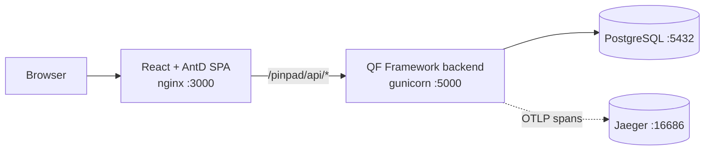

<div align="center">

# 🔐 Pinpad

### PIN-Based Room Access Registry Simulator

A demonstrative, end-to-end **access-control system** that replaces a paper key
registry. A person types a composed PIN at a room door terminal — the backend
validates it, actuates a **mocked** door, decides **ENTER** vs **EXIT**, and
writes an immutable audit event. Everything is observable in a live dashboard
and traced in Jaeger.

```
  ┌───────────────┐
  │   1234 0023   │   12340023  =  1234 (room PIN)  +  0023 (person code)
  └───────────────┘
        keypad        not inside → ENTER     ·     already inside → EXIT
```


</div>

---

## ✨ Features

- **Pinpad kiosk** — a full-screen door terminal with a numeric keypad. Enter
  → an in-room *"Do you want to exit?"* screen so enters and exits are explicit
  and paired in the registry. If a person chooses *Stay*, they're never stuck:
  the keypad lists who's **currently inside** with tap-to-exit (or just re-enter
  the code).
- **Smart ENTER/EXIT** — direction is derived from current presence, not chosen
  by the user.
- **Admin back office** — CRUD for people, rooms (PINs hashed on save), and
  access permissions.
- **Append-only registry** — every attempt recorded with a masked code
  (`****0023`), filterable and paginated.
- **Live monitoring** — KPIs, current room occupancy, door states, recent
  denials (auto-refreshing).
- **English and Romanian UI** — switch language from the sidebar (or the header
  on mobile). The choice is remembered per browser; on a first visit the browser
  language is used when it is supported, otherwise English. Dates and numbers
  follow the chosen language and API error codes are shown as translated text.
- **Mock door hardware** — drive abnormal states (offline, sensor-error,
  forced-open) from a simulator page to demo failure scenarios.
- **Distributed tracing** — custom domain spans across the access flow, nested
  with auto Flask/SQLAlchemy spans, exported to Jaeger.
- **One-command deploy** — `docker compose up` brings up the whole stack and
  seeds demo data.

## 🧱 Stack

| Layer | Technology |
|-------|------------|
| Backend | Python 3.12 · **QF Framework** (JSON-declared dynamic endpoints over Flask + Flask-RESTX) |
| Data | SQLAlchemy 2.x · PostgreSQL 16 · Alembic |
| Security | bcrypt PIN hashing · entered-code masking |
| Tracing | OpenTelemetry → Jaeger (OTLP gRPC) |
| Frontend | React 19 · TypeScript · Vite · Ant Design 5 · TanStack Query · Zustand · i18next |
| Deploy | Docker Compose (postgres · jaeger · backend · frontend/nginx) |

## 🗺️ Architecture at a glance



Routes are declared as data in `maps/endpoint.json` and dispatched by the QF
router to thin handlers — `(app, operation, request, **kwargs) → (body, status)`
— which call one domain service each. The whole API is served under the
`/pinpad` namespace; the SPA's axios `baseURL` is `/pinpad` and Vite (dev) /
nginx (prod) proxy it, so the browser sees a single origin.

📖 Full design: **[docs/architecture.md](docs/architecture.md)** ·
build & runbook: **[docs/impl_plan.md](docs/impl_plan.md)**

## 🚀 Quick start (Docker)

```bash
cp .env.example .env
docker compose up -d --build
```

| Service | URL |
|---------|-----|
| Frontend | http://localhost:3000 |
| Backend API | http://localhost:5000/pinpad |
| Jaeger UI | http://localhost:16686 |

The backend container runs `alembic upgrade head` and seeds demo data on boot.

## 🛠️ Local development

```bash
make install            # venv + QF wheel + requirements
make infra              # postgres + jaeger (docker)
cp .env.example .env
make migrate            # alembic upgrade head
make seed               # demo data
make backend            # http://localhost:5000

# in a second shell
make frontend-install
make frontend           # http://localhost:5173 (proxies /pinpad → :5000)
make frontend-test      # Vitest + React Testing Library suite
```

## 🎬 Try it — demo data & codes

| Person | Code | Room | PIN |
|--------|------|------|-----|
| John Doe | `0023` | SERVER_ROOM | `1234` |
| Maria Popescu | `0041` | ARCHIVE_ROOM | `7777` |
| Security Officer | `0099` | all three rooms | — |

| Composed code | Result |
|---------------|--------|
| `12340023` | John ENTER / EXIT Server Room |
| `77770041` | Maria ENTER / EXIT Archive Room |
| `24680023` | DENIED — John has no permission for Control Room |
| `99990023` | DENIED — wrong PIN |
| `12349999` | DENIED — unknown person |

> The pinpad screen shows a PoC "Demo codes" cheat-sheet — tap a person to
> auto-fill their full code.

**Walkthrough:**

1. **Dashboard** — rooms, occupancy, door states, recent denials.
2. **Pinpad → Server Room** → `12340023` → **GRANTED · ENTER** → *"You are in
   Server Room. Exit?"*.
3. **Registry** — the ENTER event appears with masked code `****0023`.
4. Confirm **exit** → **GRANTED · EXIT** (registry now shows the pair).
5. `99990023` → **DENIED · INVALID_ROOM_PIN**.
6. **Door Simulator** → set Server Room *offline* → `12340023` → **ERROR ·
   DOOR_CONTROLLER_OFFLINE**.
7. **Jaeger** → service `pinpad` → open an `access.attempt` trace.

## 📡 API overview

All paths are prefixed with `/pinpad`.

| Method | Path | Purpose |
|--------|------|---------|
| `POST` | `/api/access/attempt` | Submit a composed code (the core flow) |
| `GET/POST/PUT/DELETE` | `/api/people` · `/api/rooms` · `/api/permissions` | Admin CRUD |
| `GET` | `/api/pinpad/{roomCode}/hints` | Demo cheat-sheet (PIN + permitted people) |
| `GET` | `/api/registry/events` | Filterable, paginated audit log |
| `GET` | `/api/monitoring/{summary,doors,occupancy,denied-events}` | Dashboard data |
| `GET/POST` | `/api/mock-hardware/doors/...` | Inspect / drive mock doors |
| `GET` | `/health` `/liveness` `/readiness` | Health checks |

## 📁 Project structure

```
main.py                 QF FrameworkApp bootstrap (gunicorn entry: main:app)
config.py               top-level shim → src.config.Config
maps/endpoint.json      all routes (declarative)
src/
  common/               db (get_db ctx mgr) · errors · correlation/CORS ·
                        security (bcrypt) · tracing · spans
  domain/
    models.py           ORM: people, rooms, permissions, presence, events, doors
    access/             parser · validator · service  (the critical flow)
    people|rooms|permissions|presence|registry|hardware|monitoring/
  api/                  thin handlers, one module per resource
migrations/             Alembic
scripts/seed.py         demo data
frontend/               Vite + AntD SPA (pages, api client, stores, i18n)
docs/                   architecture.md · impl_plan.md
```

## 🔍 Observability

Tracing is on by default (`ENABLE_TRACING=true`) and exports OTLP/gRPC to
Jaeger. The access flow emits a span tree:

```
access.attempt                       (decision, reason, event_type, person_code)
├── access.parse
├── access.validate                  (allowed, reason)
├── access.door_unlock → door.unlock (state_before/after)
├── access.presence                  (event_type)
└── access.registry_write
        └── SELECT / INSERT / UPDATE  (auto SQLAlchemy spans)
```

## 🔒 Security notes (PoC)

- Room PINs are stored as **bcrypt hashes**, never plaintext (`demo_pin` is a
  deliberate PoC-only convenience for the kiosk cheat-sheet).
- The entered code is **masked** (`****0023`) everywhere — the PIN is never
  persisted in logs or the registry.
- The registry is **append-only**: there are no update/delete endpoints for
  events.
- A **partial unique index** (`active = true`) on `room_presence` plus a
  `SELECT ... FOR UPDATE` on the room guard the ENTER/EXIT race.
- There is **no authentication** yet — the architecture anticipates Keycloak
  OIDC + RBAC as the production path.

## 📚 Documentation

- [docs/architecture.md](docs/architecture.md) — system design, domain model,
  flows, security, observability, deployment.
- [docs/impl_plan.md](docs/impl_plan.md) — build phases, API surface, runbook,
  testing strategy, acceptance criteria.

---

<div align="center">
<sub>Demonstrative PoC — built to evolve into a production access-control platform.</sub>
</div>
