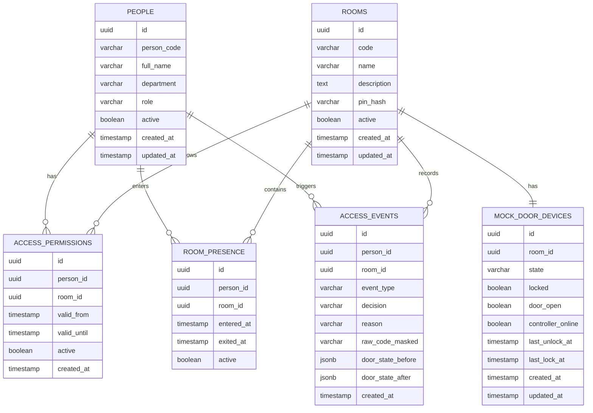
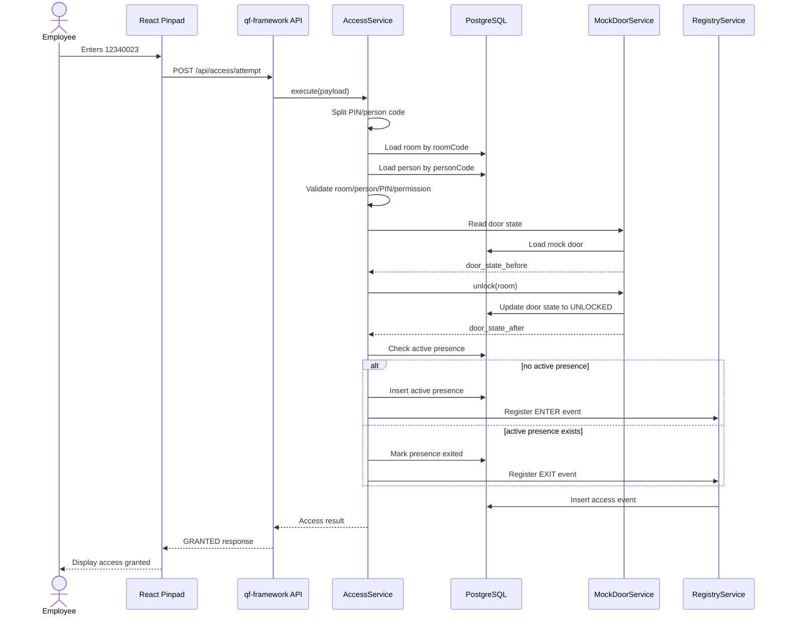
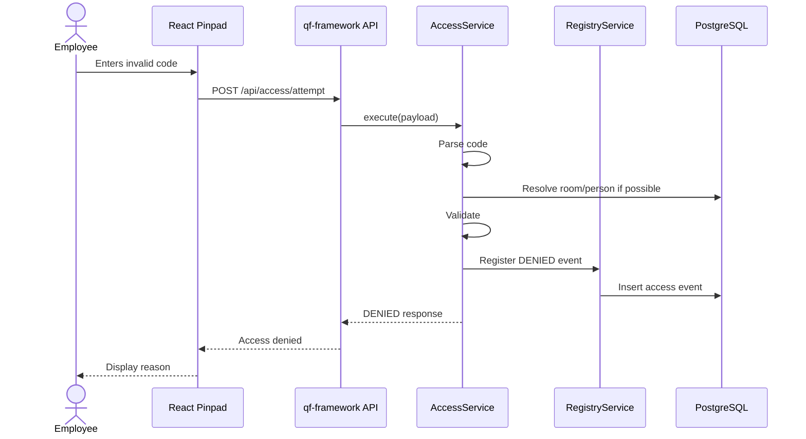
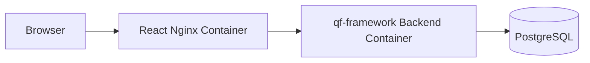

# Architecture.md — PIN-Based Room Access Registry Simulator

## 1. Purpose

This document describes the architecture of a demonstrative **PIN-Based Room Access Registry Simulator**.

The system replaces a manual process where employees physically take keys from a sealed black box and write entries in a paper registry. Instead, it simulates a centralized access-control system where a person enters a composed PIN at a room door, the central system validates the access attempt, unlocks a mocked door, and automatically writes a digital registry event.

The solution is intentionally designed as a fast demonstrative PoC, but with a structure that can evolve into a production-grade access-control platform.

---

## 2. Business Problem

Current manual process:

1. Employee arrives at work.
2. Employee goes to a dedicated room.
3. Employee opens or unseals a black box.
4. Employee takes a room key.
5. Employee writes in a registry that the key was taken.
6. After work, employee returns the key.
7. Employee reseals the box.
8. Employee writes in the registry that the key was returned.

Problems:

- Manual registry can be incomplete or inaccurate.
- Key custody is difficult to audit.
- No automatic timestamping.
- No automatic access validation.
- No real-time monitoring.
- No central visibility over who entered or exited.
- Sealing/unsealing process is slow and operationally fragile.
- Security depends heavily on human discipline.

Proposed digital process:

1. Employee enters a composed access code at the room door.
2. Central backend validates the person, room, PIN, and permission.
3. Mocked door hardware unlocks.
4. Registry event is written automatically.
5. Monitoring dashboard shows door state, presence, granted/denied events, and audit trail.

---

## 3. Scope

### 3.1 In Scope

The PoC includes:

- Python backend using qf-framework.
- React administration and monitoring frontend.
- Mocked pinpad page.
- Mocked door hardware service.
- Person management.
- Room management.
- Room access permission management.
- PIN-based access attempt flow.
- Automatic enter/exit detection.
- Digital registry/audit log.
- Door state simulation.
- Monitoring dashboard.
- Docker Compose deployment.
- PostgreSQL database.
- Seed data for demo.

### 3.2 Out of Scope for PoC

The first version does not include:

- Real physical pinpad integration.
- Real electric door lock integration.
- Real badge/card reader integration.
- Biometric authentication.
- Real-time WebSocket updates, unless time permits.
- Advanced reporting.
- Multi-building support.
- Production-grade identity provider integration.
- Hardware encryption modules.
- Offline edge controller synchronization.

These can be added later.

---

## 4. Main Concept

The central idea is:

```text
PIN + person code -> central validation -> mocked door unlock -> automatic registry event
```

Example code:

```text
12340023
```

The code is split as:

```text
1234 = room PIN
0023 = person code
```

The backend validates:

- Is the room active?
- Is the person active?
- Is the room PIN correct?
- Does the person have permission for this room?
- Is the door controller online?
- Is the current access state consistent?

Then the system decides whether the event is:

```text
ENTER
```

or:

```text
EXIT
```

If the person is not currently inside the room, the event is interpreted as `ENTER`.

If the person is already inside the room, the event is interpreted as `EXIT`.

---

## 5. High-Level Architecture

```mermaid
flowchart LR
    User[Employee / Admin User]

    subgraph Frontend[React Frontend]
        Pinpad[Mock Pinpad Page]
        Admin[Admin CRUD Pages]
        Monitoring[Monitoring Dashboard]
        Audit[Registry / Audit Page]
        DoorSim[Door Simulator Page]
    end

    subgraph Backend[Python qf-framework Backend]
        DynamicAPI[qf-framework Dynamic API Layer]
        AccessService[Access Control Service]
        PinpadService[Mock Pinpad Service]
        DoorService[Mock Door Hardware Service]
        RegistryService[Registry Service]
        AdminServices[Admin CRUD Services]
        AuditService[Audit Service]
        MonitoringService[Monitoring Service]
    end

    subgraph DB[(PostgreSQL)]
        People[(people)]
        Rooms[(rooms)]
        Permissions[(access_permissions)]
        Presence[(room_presence)]
        Events[(access_events)]
        Doors[(mock_door_devices)]
        AuditLogs[(audit_logs)]
    end

    User --> Frontend
    Pinpad --> AccessService
    Admin --> AdminServices
    Monitoring --> MonitoringService
    Audit --> RegistryService
    DoorSim --> DoorService

    DynamicAPI --> AccessService
    DynamicAPI --> AdminServices
    DynamicAPI --> RegistryService
    DynamicAPI --> MonitoringService

    AccessService --> DoorService
    AccessService --> RegistryService
    AccessService --> DB
    AdminServices --> DB
    DoorService --> Doors
    RegistryService --> Events
    MonitoringService --> DB
```

---

## 6. Logical Components

### 6.1 React Frontend

The frontend provides both the user-facing simulated hardware interaction and the administrative back office.

Main frontend areas:

```text
/pinpad/:roomCode
/dashboard
/people
/rooms
/permissions
/registry
/monitoring
/hardware
```

Responsibilities:

- Render mocked numeric pinpad.
- Send access attempts to backend.
- Display access granted/denied result.
- Show door unlock simulation.
- Manage people, rooms, and permissions.
- Display audit registry.
- Display current room occupancy.
- Display mocked hardware state.
- Trigger manual hardware simulation actions.

---

### 6.2 qf-framework Backend

The backend is the central system. It owns all business decisions.

Responsibilities:

- Expose REST APIs.
- Validate access attempts.
- Split composed PIN into room PIN and person code.
- Verify room PIN using secure hash.
- Verify person exists and is active.
- Verify access permission.
- Determine ENTER or EXIT.
- Update room presence.
- Mock door unlock/lock behavior.
- Persist access events.
- Expose monitoring data.
- Expose CRUD endpoints.

The qf-framework dynamic API layer can be used for CRUD-style endpoints, while critical business flows such as access attempts should be implemented explicitly in domain services.

---

### 6.3 Mock Pinpad

The pinpad is not a separate physical device in the PoC. It is a React page that mimics a keypad mounted near a room door.

Responsibilities:

- Show room name.
- Provide numeric buttons.
- Accept 8-digit composed code.
- Submit to backend.
- Show result:
  - Access granted.
  - Access denied.
  - Door unlocked.
  - Enter/exit registered.
- Optionally display countdown while door is unlocked.

---

### 6.4 Mock Door Hardware

The mock door hardware is implemented in backend state and displayed in React.

Door state is stored in the database and manipulated by backend services.

Possible states:

```text
LOCKED
UNLOCKED
FORCED_OPEN
SENSOR_ERROR
OFFLINE
```

Normal access flow:

```text
LOCKED -> UNLOCKED -> LOCKED
```

The mocked door should support manual simulation:

- Unlock.
- Lock.
- Force open.
- Set offline.
- Set online.
- Sensor error.

This allows demos of abnormal scenarios.

---

### 6.5 Registry and Audit

The registry replaces the paper registry.

Each access attempt creates an event:

- Granted ENTER.
- Granted EXIT.
- Denied unknown person.
- Denied wrong PIN.
- Denied no permission.
- Denied inactive person.
- Denied inactive room.
- Error hardware offline.
- Error inconsistent hardware state.

The registry is append-only from a business perspective. Existing events should not be modified by normal users.

---

## 7. Domain Model

### 7.1 Person

Represents an employee or authorized user.

Fields:

```text
id
person_code
full_name
department
role
active
created_at
updated_at
```

Example:

```json
{
  "person_code": "0023",
  "full_name": "John Doe",
  "department": "IT",
  "role": "Engineer",
  "active": true
}
```

---

### 7.2 Room

Represents a protected room.

Fields:

```text
id
code
name
description
pin_hash
active
created_at
updated_at
```

The room PIN must not be stored in clear text. It should be hashed using bcrypt or argon2.

Example:

```json
{
  "code": "SERVER_ROOM",
  "name": "Server Room",
  "description": "Restricted infrastructure room",
  "active": true
}
```

---

### 7.3 AccessPermission

Defines who may access which room.

Fields:

```text
id
person_id
room_id
valid_from
valid_until
active
created_at
```

Business rules:

- Permission must be active.
- If `valid_from` is defined, current time must be after it.
- If `valid_until` is defined, current time must be before it.
- A person can have at most one active permission relation per room.

---

### 7.4 RoomPresence

Tracks who is currently inside a room.

Fields:

```text
id
person_id
room_id
entered_at
exited_at
active
```

Business rule:

- One active presence row per person per room.
- If active presence exists, next valid access attempt becomes `EXIT`.
- If no active presence exists, next valid access attempt becomes `ENTER`.

---

### 7.5 AccessEvent

Represents an immutable registry/audit event.

Fields:

```text
id
person_id
room_id
event_type
decision
reason
raw_code_masked
door_state_before
door_state_after
created_at
```

Possible `event_type` values:

```text
ENTER
EXIT
DENIED
HARDWARE_EVENT
SYSTEM_ERROR
```

Possible `decision` values:

```text
GRANTED
DENIED
ERROR
```

Examples:

```json
{
  "event_type": "ENTER",
  "decision": "GRANTED",
  "reason": null,
  "raw_code_masked": "****0023"
}
```

```json
{
  "event_type": "DENIED",
  "decision": "DENIED",
  "reason": "PERSON_HAS_NO_PERMISSION_FOR_ROOM",
  "raw_code_masked": "****0023"
}
```

---

### 7.6 MockDoorDevice

Represents simulated hardware attached to a room.

Fields:

```text
id
room_id
state
locked
door_open
controller_online
last_unlock_at
last_lock_at
created_at
updated_at
```

---

## 8. Database Schema



---

## 9. API Architecture

### 9.1 Access API

#### Submit access attempt

```http
POST /api/access/attempt
```

Request:

```json
{
  "roomCode": "SERVER_ROOM",
  "enteredCode": "12340023"
}
```

Response, granted:

```json
{
  "decision": "GRANTED",
  "eventType": "ENTER",
  "message": "Access granted. ENTER registered.",
  "person": {
    "code": "0023",
    "fullName": "John Doe"
  },
  "room": {
    "code": "SERVER_ROOM",
    "name": "Server Room"
  },
  "door": {
    "state": "UNLOCKED",
    "locked": false,
    "doorOpen": false,
    "controllerOnline": true
  }
}
```

Response, denied:

```json
{
  "decision": "DENIED",
  "eventType": "DENIED",
  "reason": "INVALID_ROOM_PIN",
  "message": "Access denied."
}
```

---

### 9.2 People API

```http
GET    /api/people
POST   /api/people
GET    /api/people/{id}
PUT    /api/people/{id}
DELETE /api/people/{id}
```

---

### 9.3 Rooms API

```http
GET    /api/rooms
POST   /api/rooms
GET    /api/rooms/{id}
PUT    /api/rooms/{id}
DELETE /api/rooms/{id}
```

Room create request:

```json
{
  "code": "SERVER_ROOM",
  "name": "Server Room",
  "description": "Restricted room",
  "pin": "1234",
  "active": true
}
```

The backend hashes `pin` before storage.

---

### 9.4 Permissions API

```http
GET    /api/permissions
POST   /api/permissions
DELETE /api/permissions/{id}
```

Create permission:

```json
{
  "personId": "uuid",
  "roomId": "uuid",
  "validFrom": "2026-05-01T00:00:00",
  "validUntil": null,
  "active": true
}
```

---

### 9.5 Registry API

```http
GET /api/registry/events
GET /api/registry/presence
GET /api/registry/room/{roomCode}
GET /api/registry/person/{personCode}
```

Filters:

```text
roomCode
personCode
eventType
decision
from
to
page
size
sort
```

---

### 9.6 Mock Hardware API

```http
GET  /api/mock-hardware/doors
GET  /api/mock-hardware/doors/{roomCode}
POST /api/mock-hardware/doors/{roomCode}/unlock
POST /api/mock-hardware/doors/{roomCode}/lock
POST /api/mock-hardware/doors/{roomCode}/force-open
POST /api/mock-hardware/doors/{roomCode}/sensor-error
POST /api/mock-hardware/doors/{roomCode}/offline
POST /api/mock-hardware/doors/{roomCode}/online
```

---

### 9.7 Monitoring API

```http
GET /api/monitoring/summary
GET /api/monitoring/doors
GET /api/monitoring/occupancy
GET /api/monitoring/denied-events
```

---

## 10. qf-framework Endpoint Mapping

CRUD endpoints can be described in `maps/endpoint.json`.

Example:

```json
{
  "endpoints": [
    {
      "name": "people_list_create",
      "route": "/api/people",
      "methods": ["GET", "POST"],
      "service": "domain.people.service.PeopleService",
      "request_model": {
        "person_code": "string",
        "full_name": "string",
        "department": "string",
        "role": "string",
        "active": "boolean"
      }
    },
    {
      "name": "rooms_list_create",
      "route": "/api/rooms",
      "methods": ["GET", "POST"],
      "service": "domain.rooms.service.RoomService",
      "request_model": {
        "code": "string",
        "name": "string",
        "description": "string",
        "pin": "string",
        "active": "boolean"
      }
    },
    {
      "name": "access_attempt",
      "route": "/api/access/attempt",
      "methods": ["POST"],
      "service": "domain.access.service.AccessService",
      "request_model": {
        "roomCode": "string",
        "enteredCode": "string"
      }
    }
  ]
}
```

Recommendation:

- Use dynamic APIs for simple CRUD.
- Use explicit service orchestration for access attempts.
- Keep all critical domain logic outside generic controllers.

---

## 11. Main Access Flow



---

## 12. Denied Access Flow



---

## 13. Access Validation Rules

Validation order should be deterministic.

Recommended order:

1. Validate request shape.
2. Validate `enteredCode` contains only digits.
3. Validate `enteredCode` has expected length.
4. Split code into `pin` and `person_code`.
5. Load room by `roomCode`.
6. Load person by `person_code`.
7. Verify room exists.
8. Verify person exists.
9. Verify room is active.
10. Verify person is active.
11. Verify room PIN hash.
12. Verify active permission.
13. Verify permission time window.
14. Verify door controller is online.
15. Verify door is not in fatal state.

Reason codes:

```text
INVALID_CODE_FORMAT
INVALID_CODE_LENGTH
ROOM_NOT_FOUND
PERSON_NOT_FOUND
ROOM_INACTIVE
PERSON_INACTIVE
INVALID_ROOM_PIN
PERSON_HAS_NO_PERMISSION_FOR_ROOM
PERMISSION_NOT_YET_VALID
PERMISSION_EXPIRED
DOOR_CONTROLLER_OFFLINE
DOOR_SENSOR_ERROR
UNKNOWN_ERROR
```

---

## 14. Security Architecture

### 14.1 PIN Storage

Room PINs must be hashed.

Use:

```text
bcrypt
```

or:

```text
argon2
```

The PoC can use bcrypt because it is simple and widely available.

Never store this:

```text
1234
```

Store:

```text
$2b$12$...
```

---

### 14.2 Code Masking

The full entered code must never be stored in logs or registry.

Given:

```text
12340023
```

Store:

```text
****0023
```

This keeps the person code visible for audit while hiding the PIN.

---

### 14.3 Audit Immutability

For the PoC:

- Do not expose update/delete endpoints for access events.
- Use append-only access event creation.

For production:

- Add cryptographic hash chaining for audit events.
- Store actor and source IP.
- Add tamper detection.
- Export signed reports.

---

### 14.4 Authentication

PoC options:

- Simple admin login.
- Static development token.
- No login for local demo, but mocked admin identity.

Production target:

- Keycloak OIDC.
- Role-based access control.
- Admin, security officer, viewer, auditor roles.

---

## 15. Concurrency and Consistency

The access attempt flow should be transactional.

Critical sections:

- Presence check.
- Presence insert/update.
- Registry event insert.
- Door state update.

Use database transaction boundaries.

Recommended behavior:

```text
BEGIN TRANSACTION
  validate
  lock room or presence rows
  update door state
  update presence
  insert access event
COMMIT
```

Avoid this race:

```text
Two requests for same person/room arrive at same time.
Both detect no active presence.
Both create ENTER events.
```

Mitigation:

- Use `SELECT ... FOR UPDATE` on relevant presence rows or room row.
- Add unique partial index for active presence:
  - one active row per person-room pair.

Example partial unique index:

```sql
CREATE UNIQUE INDEX ux_active_presence_person_room
ON room_presence(person_id, room_id)
WHERE active = true;
```

---

## 16. Observability

For demo:

- Structured logs.
- Request ID.
- Access event ID.
- Door state transition logs.
- Error logs.

Recommended log context:

```json
{
  "request_id": "abc",
  "room_code": "SERVER_ROOM",
  "person_code": "0023",
  "decision": "GRANTED",
  "event_type": "ENTER"
}
```

Future optional integration:

- OpenTelemetry tracing.
- Jaeger.
- Prometheus metrics.
- Grafana dashboard.

Useful metrics:

```text
access_attempts_total
access_granted_total
access_denied_total
door_unlock_total
door_offline_total
current_occupancy
```

---

## 17. Frontend Architecture

### 17.1 Technology Stack

Recommended:

```text
React
TypeScript
Vite
React Router
TanStack Query
Axios
React Hook Form
Zod
MUI or Ant Design
```

### 17.2 Folder Structure

```text
frontend/
  src/
    api/
      client.ts
      accessApi.ts
      peopleApi.ts
      roomsApi.ts
      permissionsApi.ts
      registryApi.ts
      monitoringApi.ts
      hardwareApi.ts

    components/
      layout/
        AppLayout.tsx
        Sidebar.tsx
        Header.tsx

      common/
        DataTable.tsx
        StatusBadge.tsx
        ConfirmDialog.tsx

      pinpad/
        NumericPinpad.tsx
        AccessResultPanel.tsx

      hardware/
        DoorStateCard.tsx

    pages/
      DashboardPage.tsx
      PinpadPage.tsx
      PeoplePage.tsx
      RoomsPage.tsx
      PermissionsPage.tsx
      RegistryPage.tsx
      MonitoringPage.tsx
      DoorSimulatorPage.tsx

    types/
      access.ts
      people.ts
      rooms.ts
      registry.ts
      hardware.ts
      monitoring.ts

    App.tsx
    main.tsx
```

---

## 18. Deployment Architecture

### 18.1 Docker Compose



Services:

```text
postgres
backend
frontend
```

Optional later:

```text
redis
jaeger
prometheus
grafana
```

---

## 19. Demo Script

Recommended demo flow:

1. Open dashboard.
2. Show active rooms and door states.
3. Open people CRUD.
4. Show John Doe with person code `0023`.
5. Open rooms CRUD.
6. Show Server Room with PIN configured.
7. Open permissions.
8. Show John has permission to Server Room.
9. Open `/pinpad/SERVER_ROOM`.
10. Enter `12340023`.
11. Show access granted and `ENTER`.
12. Open registry.
13. Show event recorded.
14. Enter `12340023` again.
15. Show access granted and `EXIT`.
16. Enter wrong code `99990023`.
17. Show access denied.
18. Open hardware simulator.
19. Set door offline.
20. Try valid code again.
21. Show denied/error because controller is offline.

---

## 20. Future Evolution

The PoC can evolve into:

- Real pinpad hardware integration via MQTT, HTTP, or serial gateway.
- Real relay controller for door unlock.
- Keycloak authentication.
- Badge/card reader support.
- Visitor access workflows.
- Approval-based access.
- Temporary access windows.
- WebSocket real-time dashboard.
- Audit hash chaining.
- Reporting and export.
- Multi-location deployment.
- Offline edge controller.
- Kubernetes deployment.
